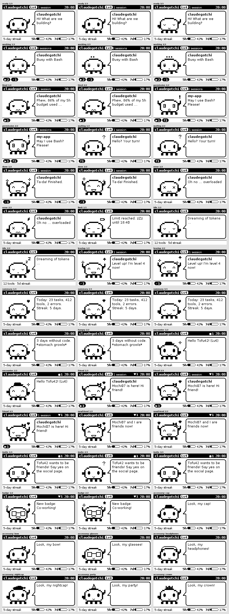

# claudegotchi

A small e-ink companion for Claude Code with its own slim operating system image.
A pixel critter shows what your Claude Code sessions are up to: working, waiting
for you, asking for permission, done, or running into a rate limit.



The idea comes from Pwnagotchi, but the image is its own thing. It is built with
Buildroot, has no Debian and no Wi-Fi hacking tools, only the Claudegotchi service
and the bare minimum around it.

```
Claude Code ── hooks + status line ──► claudegotchi_client.py ──HTTP──► Pi: claudegotchi ──► e-paper
                                          (USB cable or Wi-Fi)
```

## Moods

| Mood | When |
|---|---|
| ready | a new session started |
| working | prompt sent, tools running |
| tired | working, but 80 % or more of the 5-hour budget is used |
| permission | Claude asks for permission |
| waiting | Claude waits for your input |
| done | the reply is finished |
| error | API error (overloaded, logged out, …) |
| limit | rate limit reached, with the time it resets |
| idle | nothing going on |
| levelup | the critter just reached a new level |
| summary | idle in the evening (18–23 h): the day's tally |
| hungry | no work for two days or more |

With several sessions (e.g. worktrees), the state that needs you most wins. The
footer shows how many sessions are working (▶), waiting for you (?) or done (✓),
plus bars for the 5-hour and 7-day budget.

## Growing up

The critter earns experience from your work: 10 XP per finished reply, 5 per
completed task, 3 per new session and 1 per tool call. Levels get further apart
as it grows (level 2 at 50 XP, level 3 at 150, level 4 at 300, …), and the level
shows in the header. Every day with at least one finished reply extends the streak;
skip a day and it starts over. In the evening it shows what you did today, and when
you leave it alone for two days it gets hungry.

The progress lives in `life.json` on the image's small writable `data` partition
(`~/.claudegotchi/` in the simulator), so it survives reboots and updates of the
root filesystem. All numbers and texts are in `app/claudegotchi/mood.py`.

## Friends

Gotchis that meet in real life notice each other over Bluetooth LE, can become
friends, and earn XP, badges and accessories for it. Everything works offline;
the design leaves room for a community site with chat later
([docs/social-concept.md](docs/social-concept.md)).

* **Identity.** On first start the gotchi creates an Ed25519 key pair. The key *is*
  the profile: no sign-up, no password. Name and accessory are set on the social page.
* **Anonymous by default.** A gotchi sends a small beacon with a random id that
  changes every 15 minutes, its level, mood and accessory. Strangers cannot follow it
  around. Friends recognise it by a tag only they can compute.
* **Open for new friends.** Only when you switch this on (social page) does the
  gotchi also send its signed card with name and level, so others nearby can ask
  to be friends.
* **Friendship needs both.** One side asks, the other says yes on its social page
  (or automatically, for gotchis met on three different days, if both allow it).
  Both gotchis sign the friendship; the two signatures are a proof that a community
  site can check later without trusting anyone.
* **Game.** 20 XP for meeting a gotchi for the first time, 5 for meeting it again on
  another day, 2 for an anonymous one (encounter XP is capped at 100 a day), 30 for a
  new friend. +10 % XP while a friend nearby is working too. Badges and levels unlock
  accessories: cap, bow, glasses, headphones, night cap, party hat, crown.
* **On the display.** ♥ and the number of friends nearby (● for other gotchis) next to
  the clock; the critter waves at new gotchis and celebrates new friends.

Open `http://claudegotchi.local:8765/social` (or `/social` in the simulator) to see
who is nearby, befriend them, pick an accessory and download a **backup**. The
identity, friends and progress only live on the SD card; the backup is encrypted
with a passphrase you choose and restores everything on a new card or gotchi.

Only game data travels over Bluetooth: never session contents, folder names or
prompts. Turn it all off with `[social] enabled = false` or on the settings page.

To try it in the simulator, start it with a pretend gotchi nearby, open your gotchi
for new friends on the social page and wait a minute:

```bash
make sim FAKE=Mochi
```

Two simulators on one computer (different `PORT` and settings files) also meet each
other.

## Hardware

* Raspberry Pi Zero 2 W (default) or Pi Zero W
* Waveshare 2.13" e-Paper HAT V4 (250 × 122)
* A USB data cable to your computer (micro-USB on the port labelled **USB**, not **PWR**)

## Repository

```
app/       the service on the device (Python, Pillow)
  claudegotchi/brain.py      folds all sessions into one mood
  claudegotchi/critter.py    the pixel critter and its expressions
  claudegotchi/painter.py    header, critter, speech bubble, status bar
  claudegotchi/mood.py       all display texts (one place, ready for i18n)
  claudegotchi/displays/     display drivers (simulator, Waveshare 2.13" V4)
  claudegotchi/config.py     reads claudegotchi.toml
  claudegotchi/relay.py      listens to an ntfy topic for cloud sessions
  claudegotchi/life.py       experience, levels, streaks and daily stats
  claudegotchi/settings.py   the settings page in the browser
  claudegotchi/update.py     app updates without flashing
  claudegotchi/identity.py   the gotchi's key pair, backup and restore
  claudegotchi/social.py     encounters and friendships (the Bluetooth protocol)
  claudegotchi/radio.py      Bluetooth LE over raw HCI, and a UDP radio for the simulator
  claudegotchi/crypto.py     Ed25519, X25519, ChaCha20 in plain Python
  claudegotchi/socialpage.py the social page in the browser
  tools/mockups.py           renders docs/mockups.png
client/    hook and status line client for your computer, plus installer
os/        Buildroot extension (br2-external): defconfigs, board files, package
```

## Try it without hardware

```bash
python3 -m pip install pillow
make test
make sim                       # preview: http://localhost:8765/  (other port: make sim PORT=8766)
CLAUDEGOTCHI_URL=http://localhost:8765 python3 client/claudegotchi_client.py test
make mockups                   # every mood in docs/mockups.png
```

Python 3.9 or newer is enough on the computer.

## Build the image

On a Linux machine (Debian/Ubuntu) with the Buildroot dependencies
(`build-essential bc cpio rsync unzip file wget`):

```bash
make zero2w      # or: make zerow
```

The first build downloads Buildroot and all sources and takes about an hour.
Result: `output/zero2w/images/claudegotchi-zero2w.img.xz`. On GitHub, the workflow
`.github/workflows/image.yml` builds both images for every `v*` tag.

Flash it with Raspberry Pi Imager: *Use custom* and pick the `.img.xz`.

## Set up

After flashing, the boot partition (`CLAUDEGOTCHI`) contains `claudegotchi.toml`.
Put your Wi-Fi, token, rotation and time zone there if you need them. Without
Wi-Fi, the gotchi only talks over the USB cable: your computer gets an address
automatically and the gotchi is reachable at `192.168.77.1`.

On your computer:

```bash
python3 client/install_mac.py          # address "auto": USB first, then claudegotchi.local
python3 ~/.claude/claudegotchi/claudegotchi_client.py test
```

The installer adds hooks and a status line to `~/.claude/settings.json`, backs up
the old file, and leaves your existing hooks and status line alone.
Remove it with `python3 client/install_mac.py --uninstall`.

## Settings in the browser

Open `http://claudegotchi.local:8765/settings` (or `http://192.168.77.1:8765/settings`
over USB) to change Wi-Fi, time zone, rotation, token and relay. The page writes
`claudegotchi.toml` on the boot partition, keeps its comments, and restarts the
gotchi. Once a token is set, the page asks for it. Editing the file on the SD
card still works too.

## Updates without flashing

The Python app can be updated in place; only kernel or system changes need a new
image.

```bash
make update GOTCHI=http://claudegotchi.local:8765 TOKEN=your-token
```

This packs `app/` into `output/claudegotchi-app.tar.gz` and sends it to the gotchi.
You can also upload that file on the settings page; every GitHub release carries
one. The gotchi checks that the new version starts, keeps it in `/data/app`, and
restarts. If it crashes three times in a row right after starting, it falls back
to the version built into the image. "Back to the built-in version" on the
settings page does the same by hand.

## On the go and with Claude in the cloud

Hooks run wherever Claude Code runs. A session on your laptop reaches the gotchi
over the USB cable, or over a shared Wi-Fi such as your phone's hotspot (put it
under `[wifi]`). A session in the cloud, for example in a Claude Project, runs in
a container that cannot see your local network. For that case the gotchi can listen
to a relay: an [ntfy](https://ntfy.sh) topic. Cloud hooks publish to the topic, and
the gotchi keeps one outgoing connection to it, so it works behind any hotspot.

1. Create a relay topic and a token on your computer:

   ```bash
   python3 client/install_mac.py --new-relay
   ```

   It prints a `[server]` token and a `[relay]` url. Put both into
   `claudegotchi.toml` on the gotchi, and give it Wi-Fi (the phone hotspot works).
2. Print a setup script for the cloud environment and paste it into the
   environment's setup script:

   ```bash
   python3 client/install_mac.py --cloud-setup > cloud-setup.sh
   ```

   The script carries the client inline and installs it with `url = none`, so it
   only publishes to the relay.
3. Allow `ntfy.sh` in the cloud environment's network access settings. Without it,
   the hooks cannot reach the relay.

The topic name is the secret: anyone who knows it can read the events (metadata
only, see below) and could publish to it. The gotchi ignores relay messages
without the right token. You can also run your own ntfy server and point
`--relay` at it; set `[relay] auth` if it needs an access token.

## What is in the image

* Read-only root filesystem, `/tmp` and `/run` in RAM. Pulling the plug does not hurt the card.
* A 16 MB writable `data` partition at `/data` for the critter's progress and app updates.
* BusyBox init with a few scripts (`os/board/claudegotchi/rootfs-overlay/etc/init.d/`):
  read settings, Bluetooth, USB gadget, Wi-Fi, then the service.
* USB gadget as a CDC-ECM network adapter with a DHCP server for your computer.
* avahi for `claudegotchi.local`, NTP on Wi-Fi. Without Wi-Fi the gotchi takes the
  time from your computer.
* Bluetooth LE through the kernel's HCI socket, no bluetoothd.
* No SSH in the default image.

## Privacy

Only metadata is sent: event, session ID, folder name, tool name and limit
percentages. Prompts, code and replies never leave your computer. With a relay,
that metadata passes through the ntfy server you chose.

## Status

Version 0.3.0. The app runs in the simulator and the Buildroot defconfigs are
checked against Buildroot 2026.02.3. A full image build and a test on real
hardware are still open; for the social features this includes the Bluetooth
radio, which so far is only tested in the simulator.
